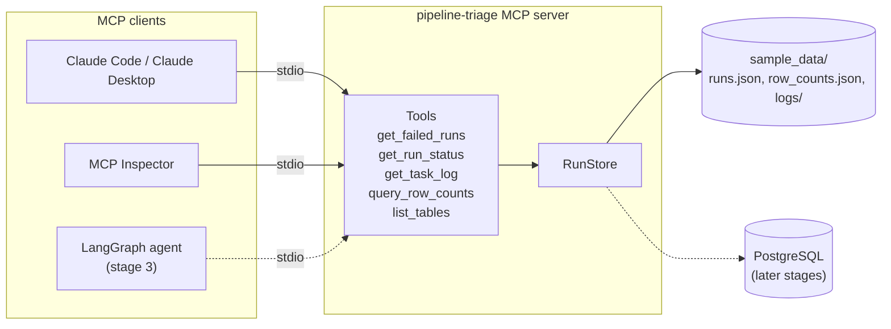

# Pipeline Triage Agent

An AI agent that investigates failed data pipeline runs the way an on-call data
engineer would: it finds the failed run, reads the failing task's log, checks
whether table volumes look wrong, looks up the matching runbook, and proposes a
root cause and a fix for a human to approve.

The project is built in four stages. **Stage 1 (this release) is the MCP server**
that gives any LLM client safe, read-only access to pipeline run status, task
logs and table row counts.

## Why MCP

The [Model Context Protocol](https://modelcontextprotocol.io) (MCP) is a standard
way to expose tools to LLM applications. Think of it as USB-C for AI tools: the
server is written once, and any MCP client can plug into it, whether that is
Claude Code, Claude Desktop, the MCP Inspector, or the LangGraph agent coming in
stage 3. The agent never touches files or databases directly; it can only call
the tools below, and every tool is read-only.

## Architecture



The tools only talk to `RunStore`. Today it reads JSON fixtures and log files;
a later stage can swap in a PostgreSQL-backed store without changing any tool.

## Tools

| Tool | What it returns |
| --- | --- |
| `get_failed_runs(dag_id?, since?, limit=20)` | Failed runs, newest first, with the names of the tasks that failed. |
| `get_run_status(run_id)` | One run's state and every task's state, try number and timings. |
| `get_task_log(run_id, task_id, tail_lines=200)` | The last lines of a task's log, and whether it was truncated. |
| `query_row_counts(table, days=7)` | Daily row counts plus the latest day's change against the earlier days' average. |
| `list_tables()` | Tables that `query_row_counts` can inspect. |

Every tool returns structured JSON with an output schema, so clients can parse
results without scraping text. Unknown ids and invalid arguments come back as
MCP tool errors with a message that says what exists, so a model can correct
itself instead of guessing.

## Sample incidents

`src/pipeline_triage/sample_data/` holds ten Airflow-style runs across four DAGs.
Five of them failed, each with a different root cause. These are the seeded
incidents that the stage 4 evals will score the agent against.

| Run | Failed task | Root cause shown in the logs |
| --- | --- | --- |
| `trip_events_daily__2026-10-28` | `validate_schema` | **Schema drift**: an upstream release renamed `speed_kmh` to `speed_kph` and changed `event_ts` to a string. |
| `driver_scores_hourly__2026-10-29T03` | `wait_for_trip_events` | **Upstream dependency**: the sensor timed out because the run above never loaded. |
| `vendor_payments_sync__2026-10-29` | `extract_vendor_api` | **Credential expiry**: the OAuth client secret expired, so the token refresh got a 401. |
| `device_health_rollup__2026-10-30` | `aggregate_metrics` | **Out of memory**: the pandas groupby blew past the pod's 4 GiB limit and was OOMKilled. |
| `trip_events_daily__2026-10-30` | `reconcile_counts` | **Partial load**: only 37 of 96 source files arrived, so rows fell 62.2% below the baseline. |

The second incident is caused by the first, which gives the agent a chance to
show it can link related failures instead of triaging each one in isolation.

## Project layout

```
src/pipeline_triage/
  models.py        Pydantic models for runs, tasks, logs and row counts
  store.py         RunStore: read-only access to the data directory
  mcp_server.py    MCP server and its tools (entry point: main)
  sample_data/     Seeded runs, row counts and task logs
tests/
  test_store.py       Unit tests for RunStore
  test_mcp_server.py  End-to-end tests through a real MCP client
```

## Local setup

Requires Python 3.11 or newer.

```bash
git clone https://github.com/RiverburnCruiser/pipeline-triage-agent.git
cd pipeline-triage-agent
python -m venv .venv
source .venv/bin/activate        # Windows: .venv\Scripts\activate
pip install -e ".[dev]"
```

Run the checks (the same ones GitHub Actions runs on every pull request):

```bash
pytest
ruff check . && ruff format --check .
mypy
```

Start the server (it speaks MCP over stdio, so it will sit waiting for a client):

```bash
pipeline-triage-mcp
```

To point it at your own data, set `TRIAGE_DATA_DIR` to a folder with the same
layout as `sample_data/`.

## Try it with an MCP client

### Claude Code

From the repo folder, with the virtual environment active:

```bash
claude mcp add pipeline-triage -- "$(which pipeline-triage-mcp)"
```

Then start `claude` and ask something like:

> Which pipeline runs failed most recently? Pick the vendor payments one, read
> the failing task's log and tell me the root cause.

Run `/mcp` inside Claude Code to check the server is connected.

### MCP Inspector

The Inspector is a web UI for calling tools by hand, which is handy for
checking schemas and error messages. It needs Node.js.

```bash
npx @modelcontextprotocol/inspector "$(which pipeline-triage-mcp)"
```

### Claude Desktop

Add this to `claude_desktop_config.json`, using the absolute path printed by
`which pipeline-triage-mcp` (on Windows, `where pipeline-triage-mcp`):

```json
{
  "mcpServers": {
    "pipeline-triage": {
      "command": "/absolute/path/to/.venv/bin/pipeline-triage-mcp"
    }
  }
}
```

## Roadmap

| Stage | Scope | Status |
| --- | --- | --- |
| 1. MCP server | Read-only tools over run status, task logs and row counts, with seeded incidents and tests. | Done |
| 2. Runbook RAG | Runbooks and past incident write-ups embedded into PostgreSQL with pgvector, exposed as a `search_runbooks` tool. | Planned |
| 3. LangGraph agent | An agent that calls the MCP tools and the runbook search, classifies the root cause, drafts a fix, and waits for human approval before any action. | Planned |
| 4. Ship it | FastAPI service, Docker Compose (app + PostgreSQL), tracing with Langfuse, and an eval suite over the seeded incidents running in GitHub Actions. | Planned |

## Design notes

- **Read-only by design.** Every tool is annotated `readOnlyHint`. The only path
  to an action will be the human approval step in stage 3.
- **No client-controlled file paths.** Log locations come from `runs.json`, and
  the store still refuses any path that resolves outside the data directory.
- **Internal fields stay internal.** The log file path is excluded from tool
  output, so clients see run and task ids only.
